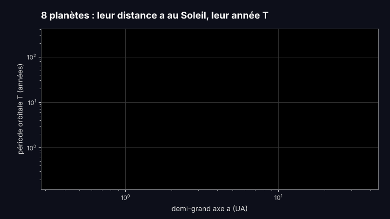

# GP_ELITE

**Trouver la formule derrière vos mesures : la régression symbolique en Python pur.**

[](https://pypi.org/project/gp-elite/)
[](https://pypi.org/project/gp-elite/)
[](https://github.com/ariel95500-create/gp-elite/actions/workflows/tests.yml)
[](LICENSE)
[](https://colab.research.google.com/github/ariel95500-create/gp-elite/blob/main/examples/quickstart.fr.ipynb)

*[🇬🇧 English version](README.md)*

GP_ELITE cherche une formule lisible qui relie vos variables à une cible, au lieu
d'une boîte noire. Il est fait pour les petits tableaux de mesures, jusqu'à une
dizaine de variables, quand on veut comprendre la relation : une loi physique,
une calibration, une corrélation d'ingénierie.



À partir des seules distances et périodes orbitales des huit planètes, il
retrouve la 3ᵉ loi de Kepler, T = a^1,5 ([`examples/kepler_demo.py`](examples/kepler_demo.py)) :

```python
import numpy as np
from gp_elite import symbolic_regression

a = np.array([0.387, 0.723, 1.000, 1.524, 5.203, 9.537, 19.191, 30.069])   # UA
T = np.array([0.241, 0.615, 1.000, 1.881, 11.862, 29.457, 84.011, 164.79])  # années

resultat = symbolic_regression(a.reshape(-1, 1), T, feature_names=["a"], generations=40, seed=0)
print(resultat.expression)   # 0.00279171 + 0.999396 * a * sqrt(a)
```

La formule est écrite dans vos variables et vos unités : en unités astronomiques
et en années, la constante de Kepler vaut 1, et c'est ce qui revient.

## Pourquoi GP_ELITE

- **Les unités physiques comme contrainte dure.** Déclarez les unités de vos
  colonnes, et la recherche ne construit que des formules dimensionnellement
  saines. Elle peut aussi donner les unités et la valeur d'une constante absente
  de vos données ([unités physiques](docs/fr/unites.md)).
- **Du Python et du NumPy, rien d'autre.** `pip install gp-elite` : pas de Julia,
  pas de compilation, pas de GPU, Python 3.9 à 3.14.
- **Mesuré, pas revendiqué.** Chaque changement destiné à améliorer la recherche
  est décidé par une comparaison écrite avant de tourner, et publiée quel qu'en
  soit le résultat
  ([comment GP_ELITE est mesuré](docs/fr/mesures.md)).
- **Ses limites sont écrites,** chacune avec la mesure qui la fonde
  ([ce que GP_ELITE ne fait pas](LIMITATIONS.fr.md)).

## Installation

```bash
pip install gp-elite
```

Ou essayez-le dans votre navigateur, sans rien installer :
[le démarrage rapide sur Colab](https://colab.research.google.com/github/ariel95500-create/gp-elite/blob/main/examples/quickstart.fr.ipynb).

## Démarrage rapide

Sur un fichier CSV, sans code : lancez `gp-elite`, choisissez le mode 6 (CSV
générique) et gardez les réglages par défaut. En Python, avec `X` un tableau de
mesures et `y` la cible :

```python
from gp_elite import symbolic_regression

if __name__ == "__main__":         # nécessaire dans un script, pas dans un notebook
    resultat = symbolic_regression(X, y, feature_names=["a", "b"])
    print(resultat.expression)     # la formule, dans vos variables
    print(resultat.r2_validation)  # son score sur des lignes tenues à l'écart (None sous 30 lignes)
```

Avec scikit-learn, `GPEliteRegressor` est un estimateur comme les autres :

```python
from gp_elite import GPEliteRegressor

est = GPEliteRegressor(units=["kg", "m/s"], target_units="J").fit(X, y)
```

[Utiliser GP_ELITE](docs/fr/utilisation.md) présente les options, la lecture du
résultat et la reproductibilité.

## Ce qu'il trouve, mesuré

Dans la mesure de sortie de la 1.4.0, cinq seeds et 30 s par ajustement, contre
la 1.3.0 mesurée à côté
([`benchmarks/results_1.4/release/`](benchmarks/results_1.4/release/)) :

| | 1.3.0 | 1.4.0 |
|---|---|---|
| 41 équations de Feynman : loi exacte (sur 205 ajustements) | 171 | 171 |
| les mêmes avec 1 % de bruit : structure de la loi (sur 205) | 116 | 152 |
| les mêmes avec 10 % de bruit : structure de la loi (sur 205) | 87 | 95 |
| les 41 avec leurs unités physiques : loi exacte (sur 205) | 174 | 174 |
| modèles rendus sous unités qui passent l'audit des unités | 1 161 sur 1 161 | 1 161 sur 1 161 |

La 1.4 place plus de graines tolérantes au bruit au début de la recherche, des
formes que ses chercheurs ajustent aux données : d'où les gains sous bruit
([nouveautés](docs/fr/caracteristiques.md#nouveautés), [CHANGELOG](CHANGELOG.md)).

La structure de la loi est retrouvée quand le modèle rendu, ses constantes
réajustées sur les données sans bruit, reproduit la loi. Sur 15 équations de
Feynman, en duel avec gplearn sur les mêmes données, GP_ELITE rend 15 lois
exactes contre 6. PySR et Operon sont plus rapides et plus précis sur les
problèmes grands ou difficiles ; GP_ELITE ne prétend pas le contraire.

## Comment les résultats sont mesurés

L'hypothèse et les critères de chaque changement destiné à améliorer la
recherche sont enregistrés avant sa première mesure. Le changement n'est adopté
que s'il les remplit, et les résultats sont publiés dans tous les cas : pour la
1.4, quatre changements ont été mesurés et trois n'ont pas été adoptés
([son plan et ses campagnes](benchmarks/results_1.4/)). La correction d'un
défaut est vérifiée à la place contre la version mesurée, comme pour celui
trouvé dans la 1.4 avant sa sortie. Chaque version est aussi
mesurée une fois sur des jeux de test figés avant toute décision et qui n'ont
jamais servi à en prendre une.

## Documentation

- [Utiliser GP_ELITE](docs/fr/utilisation.md) : la console, les options, la lecture du résultat
- [Unités physiques](docs/fr/unites.md), et les unités et la valeur d'une constante manquante
- [Régression robuste](docs/fr/robuste.md), pour des données avec des valeurs aberrantes
- [Exemples](docs/fr/exemples.md) : le vieillissement de batteries simulé, et trois études de cas sur données publiques
- [Comment GP_ELITE est mesuré](docs/fr/mesures.md) : face aux alternatives, et ce sur quoi il est bon et moins bon
- [Comment GP_ELITE est fait](docs/fr/comment-il-est-fait.md) : qui fait quoi entre l'auteur et l'assistant d'IA, et comment c'est contrôlé
- [Ce que GP_ELITE ne fait pas](LIMITATIONS.fr.md)
- [Caractéristiques techniques et historique](docs/fr/caracteristiques.md), et le [CHANGELOG](CHANGELOG.md)

## Ça n'a pas marché sur vos données ? Dites-le

GP_ELITE est réglé sur des benchmarks publiés, propres et bien échelonnés. Les
mesures réelles ne le sont pas, et c'est là que le moteur a le plus besoin de
progresser. S'il vous rend n'importe quoi sur vos données, c'est une information
utile, pas une erreur de votre part :
[ouvrez une issue](https://github.com/ariel95500-create/gp-elite/issues/new/choose)
avec la forme de vos données et ce que vous avez obtenu. Pas besoin de partager
les données elles-mêmes, et vous pouvez écrire en français comme en anglais
([CONTRIBUTING.md](CONTRIBUTING.md)).

## Licence et citation

MIT, voir [LICENSE](LICENSE) : utilisation libre, y compris commerciale, avec
conservation de la notice de copyright. Si GP_ELITE vous est utile dans un
travail académique, voir [CITATION.cff](CITATION.cff).
