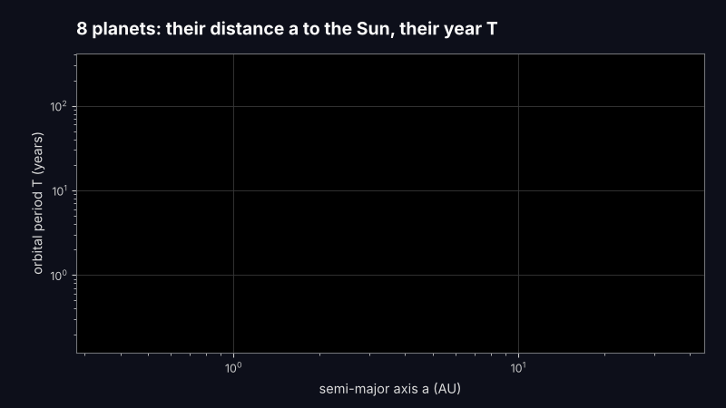

# GP_ELITE

**Find the formula behind your measurements: symbolic regression in pure Python.**

[](https://pypi.org/project/gp-elite/)
[](https://pypi.org/project/gp-elite/)
[](https://github.com/ariel95500-create/gp-elite/actions/workflows/tests.yml)
[](https://github.com/ariel95500-create/gp-elite/blob/main/LICENSE)
[](https://colab.research.google.com/github/ariel95500-create/gp-elite/blob/main/examples/quickstart.ipynb)

*[🇫🇷 Version française](https://github.com/ariel95500-create/gp-elite/blob/main/README.fr.md)*

GP_ELITE searches for a readable formula that links your variables to a target,
instead of a black box. It is built for small experimental tables, up to about
ten variables, where you want to understand the relationship: a physical law, a
calibration, an engineering correlation.



Given only the distance and the orbital period of the eight planets, it finds
Kepler's third law, T = a^1.5
([`examples/kepler_demo.py`](https://github.com/ariel95500-create/gp-elite/blob/main/examples/kepler_demo.py)):

```python
import numpy as np
from gp_elite import symbolic_regression

a = np.array([0.387, 0.723, 1.000, 1.524, 5.203, 9.537, 19.191, 30.069])   # AU
T = np.array([0.241, 0.615, 1.000, 1.881, 11.862, 29.457, 84.011, 164.79])  # years

result = symbolic_regression(a.reshape(-1, 1), T, feature_names=["a"], generations=40, seed=0)
print(result.expression)     # 0.00279171 + 0.999396 * a * sqrt(a)
```

The formula is written in your variables and units: in astronomical units and
years, Kepler's constant is 1, and that is what comes back.

## Why GP_ELITE

- **Physical units as a hard constraint.** Declare the units of your columns and
  the search builds only dimensionally sound formulas. It can also give the
  units and the value of a constant that is not in your data
  ([physical units](https://github.com/ariel95500-create/gp-elite/blob/main/docs/units.md)).
- **Pure Python and NumPy.** `pip install gp-elite`: no Julia, no compiler, no
  GPU, Python 3.9 to 3.14.
- **Measured, not claimed.** Every change meant to improve the search is
  decided by a comparison written before it runs, and published whatever the
  outcome
  ([how GP_ELITE is measured](https://github.com/ariel95500-create/gp-elite/blob/main/docs/measurements.md)).
- **Its limits are written down,** each with the measurement behind it
  ([what GP_ELITE does not do](https://github.com/ariel95500-create/gp-elite/blob/main/LIMITATIONS.md)).

## Install

```bash
pip install gp-elite
```

Or try it in your browser, with nothing to install:
[the quick start on Colab](https://colab.research.google.com/github/ariel95500-create/gp-elite/blob/main/examples/quickstart.ipynb).

## Quick start

On a CSV file, without code: run `gp-elite`, choose mode 6 (generic CSV) and
keep the defaults. In Python, with `X` a table of measurements and `y` the
target:

```python
from gp_elite import symbolic_regression

if __name__ == "__main__":         # needed in scripts, not in notebooks
    result = symbolic_regression(X, y, feature_names=["a", "b"])
    print(result.expression)       # the formula, in your variables
    print(result.r2_validation)    # its score on rows held out (None below 30 rows)
```

With scikit-learn, `GPEliteRegressor` is an estimator like the others:

```python
from gp_elite import GPEliteRegressor

est = GPEliteRegressor(units=["kg", "m/s"], target_units="J").fit(X, y)
```

[Using GP_ELITE](https://github.com/ariel95500-create/gp-elite/blob/main/docs/usage.md)
covers the options, how to read the result, and reproducibility.

## What it finds, measured

In the release measurement of 1.4.0, five seeds and 30 s per fit, against
1.3.0 measured beside it
([`benchmarks/results_1.4/release/`](https://github.com/ariel95500-create/gp-elite/tree/main/benchmarks/results_1.4/release)):

| | 1.3.0 | 1.4.0 |
|---|---|---|
| 41 Feynman equations: exact law (of 205 fits) | 171 | 171 |
| the same with 1 % noise: structure of the law (of 205) | 116 | 152 |
| the same with 10 % noise: structure of the law (of 205) | 87 | 95 |
| the 41 with their physical units: exact law (of 205) | 174 | 174 |
| models returned under units that pass the audit of units | 1,161 of 1,161 | 1,161 of 1,161 |

1.4 places more noise-tolerant seeds at the start of the search, forms its
finders fit to the data: hence the gains under noise
([what's new](https://github.com/ariel95500-create/gp-elite/blob/main/docs/features.md#whats-new),
[CHANGELOG](https://github.com/ariel95500-create/gp-elite/blob/main/CHANGELOG.md)).
1.5 changes no model: it organises the engine in modules, and at equal seed
and equal work returns the models of 1.4.0, bit for bit, at the same speed,
so these figures hold for it, within what a budget of 30 s per fit moves
between two campaigns of the same version (up to three fits on these suites)
([how the engine is organised](https://github.com/ariel95500-create/gp-elite/blob/main/docs/architecture.md)).

The structure of the law is retrieved when the returned model, its constants
refitted on the noiseless data, reproduces the law. On 15 Feynman equations, head
to head with gplearn on the same data, GP_ELITE returns 15 exact laws against 6.
PySR and Operon are faster and more accurate on large or hard problems; GP_ELITE
does not claim otherwise.

## How the results are measured

The hypothesis and the criteria of each change meant to improve the search are
committed before its first measurement. The change is adopted only if it meets
them, and the results are published either way: for 1.4, four changes were
measured and three were not adopted
([its plan and campaigns](https://github.com/ariel95500-create/gp-elite/tree/main/benchmarks/results_1.4)).
The correction of a fault is checked against the measured release instead, as
for the one found in 1.4 before its release.
Each release is also measured once on test sets frozen before any decision and
never used to make one.

## Documentation

- [Using GP_ELITE](https://github.com/ariel95500-create/gp-elite/blob/main/docs/usage.md): the console, the options, reading the result
- [Physical units](https://github.com/ariel95500-create/gp-elite/blob/main/docs/units.md), and the units and value of a missing constant
- [Robust regression](https://github.com/ariel95500-create/gp-elite/blob/main/docs/robust.md), for data with outliers
- [Examples](https://github.com/ariel95500-create/gp-elite/blob/main/docs/examples.md): simulated battery ageing, and three case studies on public data
- [How GP_ELITE is measured](https://github.com/ariel95500-create/gp-elite/blob/main/docs/measurements.md): against the alternatives, and what it is good and less good at
- [How GP_ELITE is made](https://github.com/ariel95500-create/gp-elite/blob/main/docs/how-it-is-made.md): who does what between the author and the AI assistant, and how it is checked
- [How the engine is organised](https://github.com/ariel95500-create/gp-elite/blob/main/docs/architecture.md): its modules, the shared state and `gp_elite.core`, for contributors
- [What GP_ELITE does not do](https://github.com/ariel95500-create/gp-elite/blob/main/LIMITATIONS.md)
- [Technical features and history](https://github.com/ariel95500-create/gp-elite/blob/main/docs/features.md), and the [CHANGELOG](https://github.com/ariel95500-create/gp-elite/blob/main/CHANGELOG.md)

## Did it fail on your data? Please say so

GP_ELITE is tuned on published benchmarks, which are clean and well scaled. Real
measurements are not, and that gap is where the engine most needs work. If it
returns nonsense on your data, that is useful information, not user error:
[open an issue](https://github.com/ariel95500-create/gp-elite/issues/new/choose)
with the shape of your data and what you got back. You do not need to share the
data itself, and you can write in English or French
([CONTRIBUTING.md](https://github.com/ariel95500-create/gp-elite/blob/main/CONTRIBUTING.md)).

## License and citation

MIT, see [LICENSE](https://github.com/ariel95500-create/gp-elite/blob/main/LICENSE):
free to use, including commercially, with the copyright notice kept. If GP_ELITE
is useful in academic work, see
[CITATION.cff](https://github.com/ariel95500-create/gp-elite/blob/main/CITATION.cff).
